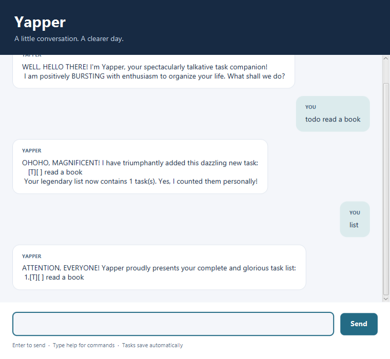

# Yapper User Guide

Yapper is a desktop task manager with a conversational interface. Type commands to keep a list of things to do,
record deadlines and events, and find tasks by description or date.



## Getting started

1. Install Java 25. Check that `java -version` reports version 25.
2. From the project folder, build `build/libs/yapper.jar` using
   `./gradlew clean jar` (Windows PowerShell: `.\gradlew.bat clean jar`).
   See the [JAR guide](jar.md) for setup details.
3. Copy `yapper.jar` into a folder where you want to keep your tasks.
4. Open a terminal in that folder and run `java -jar yapper.jar`.
5. In the window, type `help` and press Enter or click **Send**. Try `todo read book`, then `list`.

Send one command at a time. Resize the window as needed; responses wrap and the conversation scrolls. Command words and separators are lowercase and
case-sensitive. Replace text in angle brackets with your own values; do not
type the brackets. Use spaces around `/by`, `/from`, and `/to`.

## Adding tasks

| Task | Format | Example |
| --- | --- | --- |
| To-do without a date | `todo <description>` | `todo read book` |
| Deadline | `deadline <description> /by <date or time>` | `deadline return book /by 2026-10-20 1800` |
| Event | `event <description> /from <start> /to <end>` | `event study group /from 2026-10-20 1400 /to 2026-10-20 1600` |

Yapper confirms the added task and shows the new task count. Descriptions cannot
be empty or contain the pipe character (`|`), which is reserved for storage.
An event's end must be at or after its start; equal times are allowed.

Dates accept `yyyy-MM-dd` or `d/M/yyyy`, for example `2026-10-20` or `20/10/2026`.
Either can include a space and a four-digit 24-hour time, such as `1800`.
ISO local date-time text such as `2026-10-20T18:00:00` is also accepted for
deadlines and events. Dates must exist: `2026-02-29` is invalid.

A date without a time means midnight. Midnight values display as dates without
a time. Dates and times do not include a time zone; display text follows your
computer's locale.

## Viewing and updating tasks

| Command | Result |
| --- | --- |
| `list` | Show all tasks and their current numbers, starting at 1. |
| `mark <task number>` | Mark that task completed, for example `mark 1`. |
| `unmark <task number>` | Mark that task incomplete, for example `unmark 1`. |
| `delete <task number>` | Remove that task, for example `delete 1`. |
| `stats` | Show the total, completed, and pending task counts. |
| `help` | Show the command reference. |
| `bye` | Finish the conversation; close the window to exit. |

For example, adding `todo read book`, then entering `list`, shows this task line:

```text
1.[T][ ] read book
```

`[T]`, `[D]`, and `[E]` identify to-dos, deadlines, and events. `[X]` means
completed; `[ ]` means incomplete. Marking a task keeps it in the list.
Deleting a task changes the numbers of later tasks, so use `list` before
selecting another number. There is no undo command. `stats` includes all task types and does not change the list; an empty list has zero in all three counts.

## Finding tasks

Use `find <keyword>` to search descriptions, for example `find book` or
`find study group`. Matching ignores letter case and accepts a substring or
phrase. A nonempty search value is required.

Use `on <date>` to show scheduled tasks, for example `on 2026-10-20` or
`on 20/10/2026`. This command accepts dates without a time. Deadlines match
their due date; events match every date from their start date through their end
date, inclusive. Undated to-dos do not match.

Both searches include completed tasks, preserve the original list numbers, and
leave your tasks unchanged. If nothing matches, Yapper reports no results.

## Saving and troubleshooting

Yapper loads tasks from `data/yapper.txt` inside the terminal's working folder.
It saves automatically after adding, marking, unmarking, or deleting a task.
There is no separate save command. Start it from the same folder next time to
load the same list; moving only the JAR does not move your saved tasks.

- **Invalid command, date, or task number:** read the explanation, then enter a
  corrected command. Use `help` or `list` if needed.
- **Cannot load saved tasks:** Yapper reports the problem without overwriting the file or accepting task changes. Back
  up the file, then repair its contents or move it aside and restart with an
  empty list. A malformed record error includes its file line number.
- **Cannot save tasks:** check that the working folder and `data` folder are
  writable. The failed change is rolled back, including task order and completion status. Fix the problem, then retry the command.

Keep a backup of `data/yapper.txt` before editing or moving saved data.
